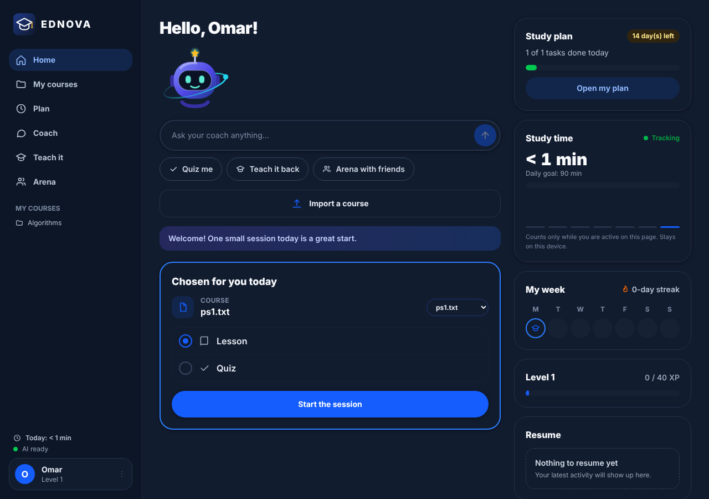
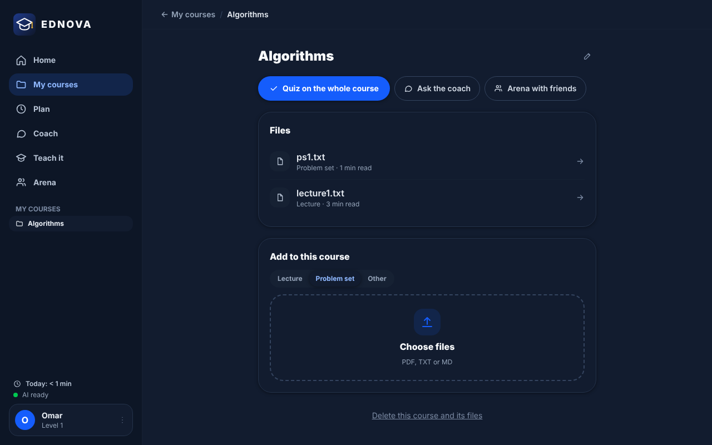
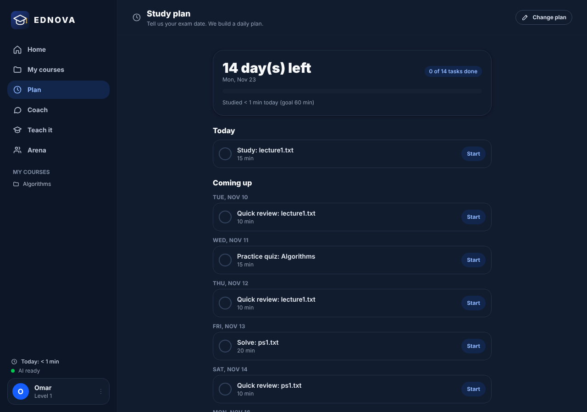
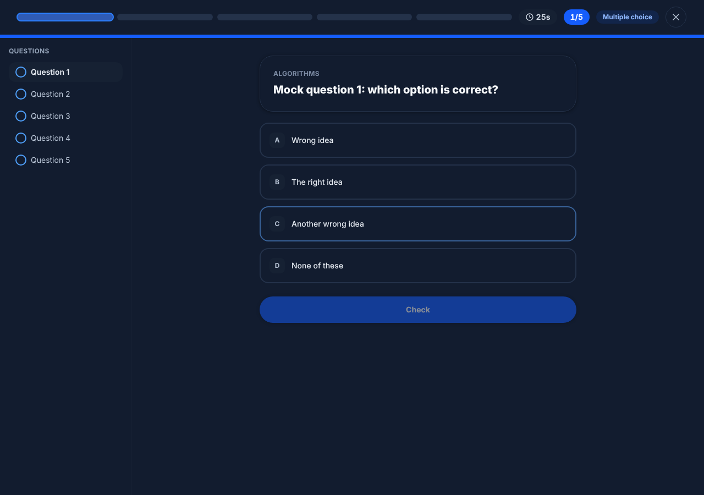
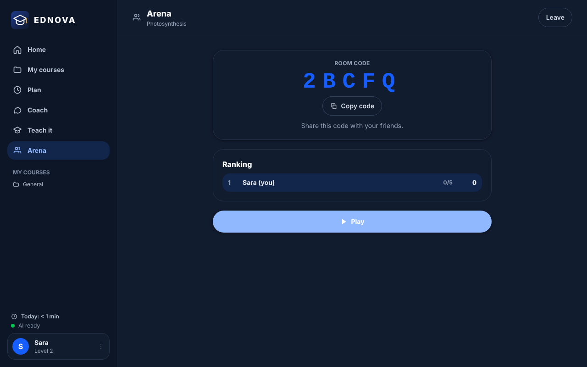
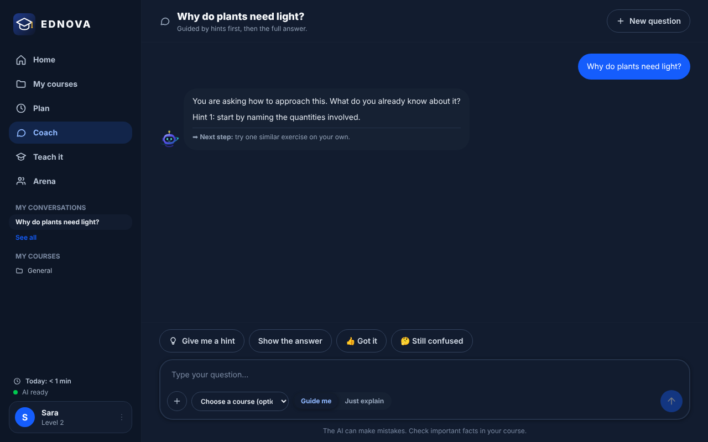
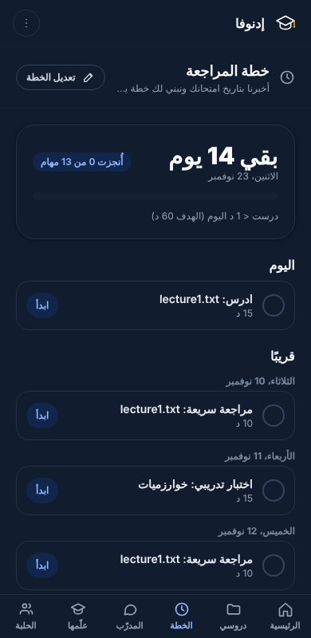

# EdNova Study Companion

A GenAI peer-learning companion: it **guides** students instead of just answering (guiding
questions, graded hints, then the full answer), adapts to each learner's style and level, turns
course PDFs into revision material, and lets learners **teach the AI back** to check their own
understanding. Built for the EdNova GenAI Peer Learning Companion challenge (IEEE WIE ACT 5.0).

## Run it (Windows PowerShell, from the project folder)

```powershell
copy .env.example .env          # then put your real key in .env (never commit it)
cd backend
pip install -r requirements.txt
python -m uvicorn main:app --reload --port 8000
```

Open http://localhost:8000. No key yet? Run with the simulated AI:

```powershell
$env:MOCK_LLM="1"; python -m uvicorn main:app --reload --port 8000
```

Tests (use the simulated AI, spend no quota): `python -m unittest discover -s tests -v`

## How the two model categories are combined (deliberate, documented choice)

| Step | Category | Why |
|---|---|---|
| Guiding question + first hint, further hints | Compact | Short, frequent, latency-sensitive |
| Simple concept explanation | Compact | Short, well-defined |
| Definitions and formulas extraction | Compact | Extraction in a fixed line format |
| Quiz generation | Compact | Structured, short |
| Learner-style diagnostic, confusion detection, level update | No AI call | Rules and counters: free and instant |
| Full worked answer ("show answer") | Large | Step-by-step reasoning |
| Document summary / revision notes | Large | Multi-excerpt synthesis |
| Teach-back feedback (peer mode) | Large | Judging correctness needs reasoning |

## Behaviour under limited capacity

All AI calls go through `backend/gateway.py`:

- **20 requests/min, 2 concurrent** (platform limits): sliding-window rate limiter (18/min margin) and a 2-slot semaphore.
- **No regeneration**: identical requests are cached; summaries, extractions and quizzes are stored per document and reused.
- **Few, rich calls**: one call per tutor turn; 3 parallel calls at most for a whole document extraction.
- **Large model slow or unavailable**: automatic fallback to the compact model, plus a 30 s circuit breaker so the next requests do not wait on a failing model. Degraded answers are never cached.
- **Never a frozen screen**: AI requests are background jobs. The interface polls them and shows the stage, elapsed time and queue state; results say which model answered and whether it was a fallback.

## Screenshots

| | |
|---|---|
|  |  |
|  |  |
|  |  |
|  | |

(Screenshots were taken with the simulated AI, so the answer texts are placeholders.)

## Technical explanation of the GenAI module

See [docs/GENAI_MODULE.md](docs/GENAI_MODULE.md): request flow, model routing, RAG workflow, gateway and capacity handling, safety.

## Privacy and ethics

Anonymous learners (random id in the browser). No names, photos, voices or addresses are collected;
upload only public or synthetic material. The AI is told never to discriminate by gender, region,
language level or background, and it supports teachers rather than replacing them.

## Layout

```
backend/   gateway.py (AI access) · features.py (tutor, peer, docs, quiz, progress) · prompts.py
           parsing.py · docs.py (PDF + retrieval) · storage.py · jobs.py · main.py (API) · tests/
frontend/  src/ (React JSX source) · dist/ (ready-to-serve offline build: app.js + styles.css) · index.html
           build.mjs (optional rebuild: `npm i react react-dom esbuild tailwindcss` then `node build.mjs`)
```

The interface needs no internet or CDN: `frontend/dist` is already built, so you only need Python.
Screens: onboarding diagnostic, home (week, level/XP, resume), My courses (one folder per course holding
lectures and problem sets; lesson, quiz, definitions, flashcards per file or for the whole course), Coach (guided hints / direct), Teach it back, Arena (shared quiz room with a 5-letter code).
Study plan (exam date -> day-by-day plan with spaced reviews, rule-based, no AI call), study-time tracker
(active time only, stays in the browser), quiz timer by level (Intermediate 40 s, Advanced 25 s per question, can be switched off).
Interface languages: English, French, Arabic (Darija uses the Arabic UI, the AI answers in Tunisian Darija).
Tests: 31 automated backend tests + `node frontend/src/plan.test.mjs` for the plan generator (`python -m pytest tests`) plus `python smoke_test.py` for the real AI.
